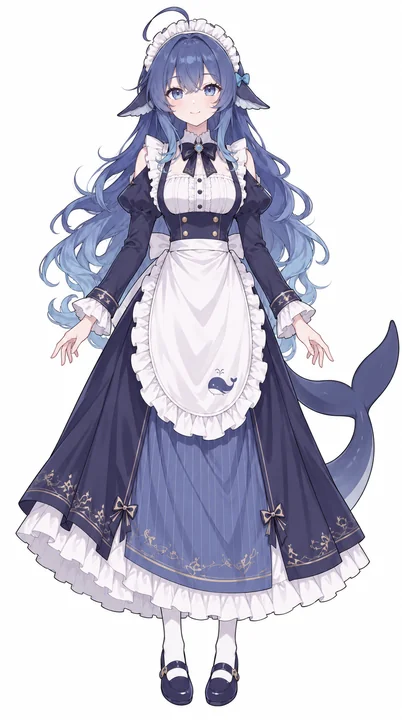
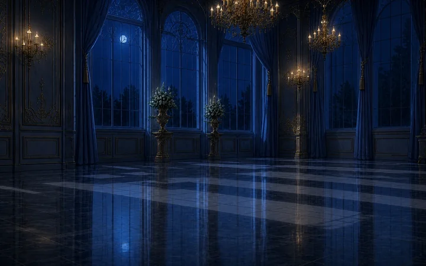
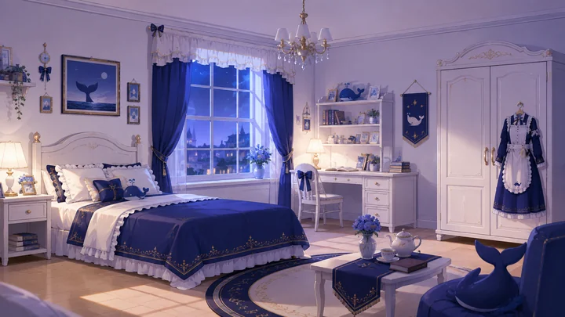

# 素材

五組素材，**授權條件不一樣**，逐項說明在 [docs/SOURCES.md](../docs/SOURCES.md)。要用在哪裡看 [選圖原則](../README.md#選圖)。

## ① original-design ｜ 設計稿

 

全身造型基準，配一張已經裁好的臉部特寫。

- `whale-avatar.png`　512 × 512 頭像，**最常用的一個**。本來就是特寫，裁圓不會切到臉。
- `whale-design.png`　937 × 1678 白底全身設計稿。
- `whale-transparent.png`　1117 × 1858 透明整稿。
- `whale-layers.psd`　44 層基礎拆分，身體遮擋補全不完整。
- 來源 [phoiex/AAAAGENT](https://github.com/phoiex/AAAAGENT) ｜ CC BY-NC-SA 4.0

## ② dsh-widget ｜ Q 版表情

 

皺眉鼓腮那個表情，適合當貼圖、小圖示、狀態指示。

- `whale-chibi.png`　610 × 610 透明 Q 版。
- `whale-chibi-hd.png`　1026 × 1026 高解析版本。
- `plugin-icon.png`　256 × 256 帶邊框的掛件圖標。
- 來源 [MeteorNOX/DeepSeek-Balance-Whale-Widget](https://github.com/MeteorNOX/DeepSeek-Balance-Whale-Widget) ｜ ⚠️ **as-is、不授予再許可**，自己用可以，不要再公開散布

## ③ maid-atelier ｜ 全身立繪

 

洋裝細節最多的一組，附夜景背景。

- `maid-left.webp`、`maid-right.webp`　1122 × 2019、1394 × 2649 透明全身。
- `palace-night.webp`　1586 × 992 夜間宮殿背景。
- `NOTICE`、`LICENSE-ARTWORK`　署名鏈與授權全文，**不要刪**。
- 來源 [Small-tailqwq/dsh-deep-whale](https://github.com/Small-tailqwq/dsh-deep-whale/tree/main/maid-atelier) ｜ CC BY-NC-SA 4.0，署名鏈是 **上善 → zipzip → Small-tailqwq** 三層

## ④ gal-view ｜ GAL 視窗插畫

 

- `whale-girl-tachie.png`　1024 × 1536 透明立繪，**目前最完整的全身圖**。
- `bedroom-bg.png`　1672 × 941 臥室背景。
- `dialogue-box.png`　1672 × 941 透明蕾絲對話框，可直接當 UI 素材。
- `lite/bedroom-bg.jpg`　背景的 JPEG 輕量版，GAL 對話頁的預設背景用這張（衍生檔，`python3 tools/derive.py` 產生）。
- 來源 `gal-view` v0.3.3（Yunicon）｜ 插件 MIT，內嵌圖片的個別作者未在文件說明

## ⑤ generated-2026-10-14 ｜ 自己生的一批

  

六類共 20 張：同臉表情 6 張、Q 版全身 1 張、橫式主視覺 5 張、教學動作 3 張、小圖案 4 張、單色線稿 1 張。可以補的缺口都補齊了。

- 檔案清單、每張的用途與完整預覽 → [generated-2026-10-14/README.md](generated-2026-10-14/README.md)
- 生成提示詞、引用來源與逐檔 SHA-256 → 同目錄的 `prompts-*.json` 與 `manifest.json`
- 衍生檔：`avatars/` 是六種表情裁成的講解框頭像（256px），`icons/on-dark/` 是深色底用的白描邊小圖案；各資料夾底下的 `lite/` 是模板用的輕量版（教學動作、主視覺轉 JPEG，小圖示縮到 256px，線稿縮到 640px）。都由 `python3 tools/derive.py` 從原圖產生
- 授權：19 張按本庫 CC BY-NC-SA 4.0 整理；Q 版參照的社群圖片授權另計，**不另外授 CC**，只在本 repo 自用

## ⑥ deepseek-icon ｜ 圓角圖標

- `whale-icon.png`　1254 × 1254，透明背景的圓角方形圖標。**四角本來就是圓的**，不用再裁。
- 用途：README 主視覺、頭像、要「App 圖標感」的地方。
- 來源：Mizimo 用 ChatGPT 內建 `image_gen` 生成（2026-09-30 下載，原檔名 `DeepSeek.png`）。沒有提示詞與參考圖紀錄。
- 授權：AI 生成素材，比照 ⑤ 按本庫 CC BY-NC-SA 4.0 整理。公開產出物上附「AI 輔助製作」揭露。詳見 [docs/SOURCES.md](../docs/SOURCES.md#六deepseek-icon--圓角圖標)。

## 校驗

`CHECKSUMS.txt` 有上面每一個檔案的 SHA-256。`original-design/assets.json` 是上游自己的校驗清單，可以對照確認沒有被改過。
