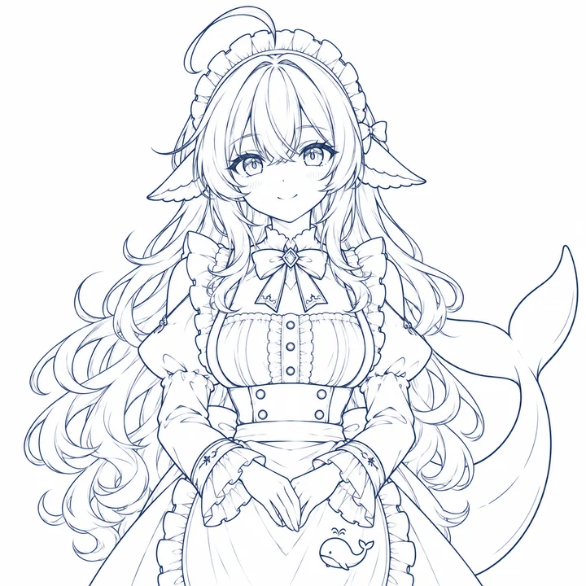
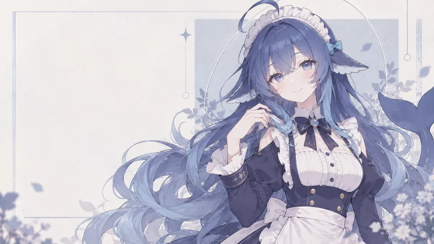
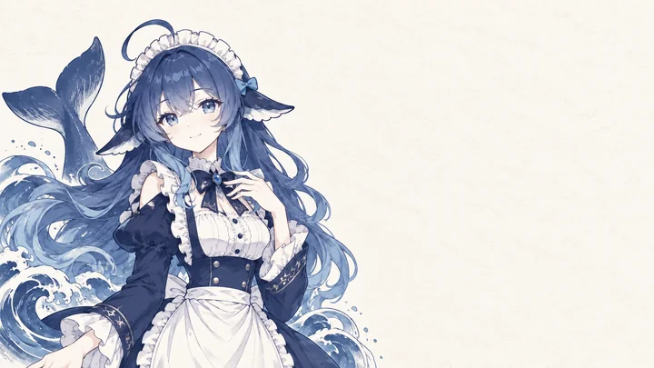
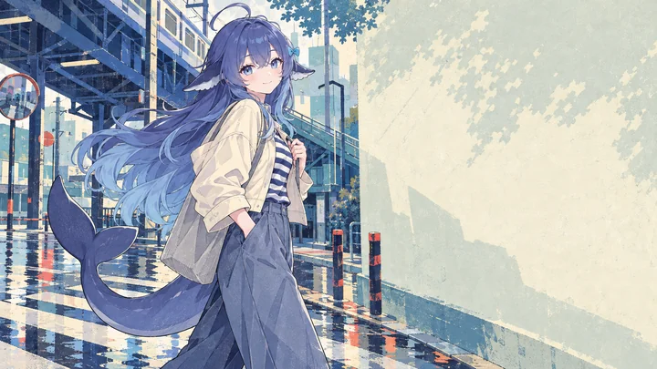
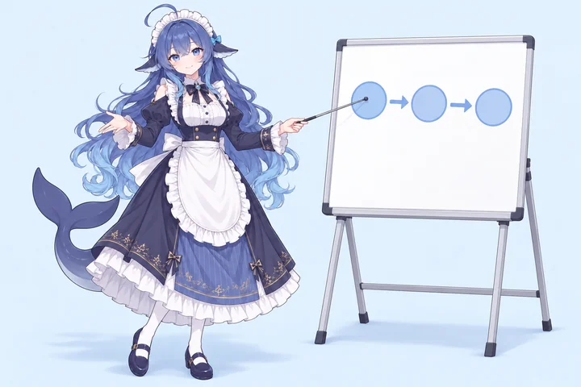
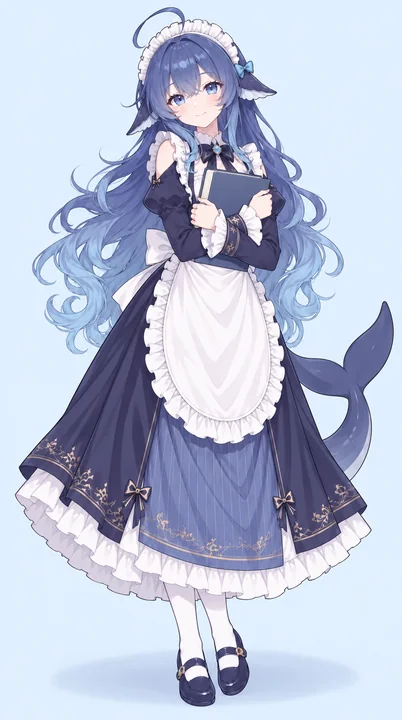
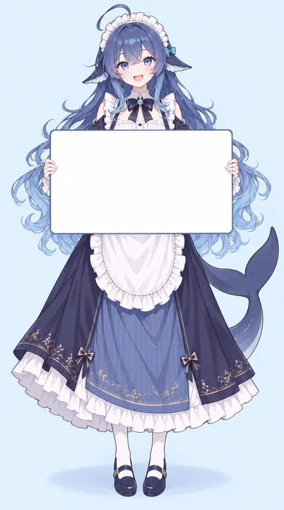

# 大肥魚補充圖片 · 2026-10-14

對照 [ART-REQUEST](../../docs/ART-REQUEST.md) 的六類需求，共 20 張，包含五款橫式主視覺。全部用內建 `image_gen` 製作，保留生成原圖供後處理。來源、授權與署名見 [SOURCES](../../docs/SOURCES.md)。

下面預覽用的是 `thumbnails/` 裡的 720px WebP（20 張加起來約 1 MB）；要看原檔（1254² 或 1672×941 的 PNG）點下面的清單連結。

## 表情差分

     

由左至右：**開心**、**苦惱**、**生氣**、**驚訝**、**想睡**、**認真**。六張用同一張基準臉，只換眉眼嘴，都是 1254×1254 不透明方圖；當貼圖要先去背。

### 講解框頭像

     

`avatars/` 是同六張裁成的 256px 方圖，取景跟 `original-design/whale-avatar.png` 一致（雙眼約在 48% 高度），直接放進講解框的圓形頭像，依內容挑表情。

## Q 版全身與單色線稿

 

Q 版以 Neko3000 的 chibi 主參考 0067 為主要依據，TreapGoGo 的 Q 版三視圖補充造型與站姿；採圓潤大頭、短四肢、清晰深藍描線、柔和賽璐璐陰影與蓬開短裙，保留完整站姿與原生淺米白背景。

線稿是白底深藍線條。另有去背版 [whale-line-art-transparent.png](line-art/whale-line-art-transparent.png)：用亮度反推 alpha，疊回白底會重現原圖；疊在深色底上會偏淡，因為原稿的線本身就淡。

## 橫式主視覺

五張皆為原生 1672×941，接近 16:9，預留一側供標題排版；沒有加入文字。上方是原版，下面是四款追加方向。

 

**低彩度時裝編輯插畫**（左）：淡紫灰藍、細描線、柔霧紙感、幾何構圖。**限色手繪版畫**（右）：深藍排線、限色印刷感與米白紙紋。這兩款是選定保留的版本。

當簡報封面時，標題要放在留白那一側：editorial 和原版留白在左，ink-print 和 casual 在右（封面加 `.right`），cinematic 沒有乾淨留白（加 `.scrim`）。完整的選圖規則見 [README 的選圖](../../README.md#選圖)。

  

**窗光電影感**：有空氣感的環境光、窗框透視與海景遠景。**都市便服**：雨後高架車站街角、短夾克與條紋上衣、寬褲、帆布包；色塊與手繪紙紋。**原版**：藍白漸層與水波，半身。

畫風研究參照 [VISIONS 2026 官方公開試閱](https://visions.pr-pixiv.net/2026/en/sample/) 的光影、限色筆觸與時裝編輯構圖。便服版保留藍髮、鰭耳、呆毛與鯨尾，換掉女僕制服。各張的實際參考與提示詞見下方 JSON。

## 教學動作

 

教鞭指向無字簡圖；筆記本沒有標題；牌面完整留空，方便自己填字。抱筆記本與舉空白牌是直式 937×1678，教鞭那張是橫式 1536×1024。

## 小圖案

四張皆有透明 alpha，都是 1254×1254，用時自己縮。深藍描邊在深色底上會消失，深色底改用 `icons/on-dark/` 的白描邊版。

   

## 原檔清單

- **表情差分**（6 張，1254×1254，淺色背景）：[開心](expressions/whale-happy.png)、[苦惱](expressions/whale-troubled.png)、[生氣](expressions/whale-angry.png)、[驚訝](expressions/whale-surprised.png)、[想睡](expressions/whale-sleepy.png)、[認真](expressions/whale-serious.png)
- **Q 版全身站姿**（1254×1254，不透明淺米白）：[whale-chibi-standing.png](chibi/whale-chibi-standing.png)
- **橫式主視覺**（5 張，1672×941）：[原版半身](key-visual/whale-key-visual-16x9.png)、[窗光電影感](key-visual/whale-key-visual-cinematic.png)、[低彩度時裝編輯插畫](key-visual/whale-key-visual-editorial.png)、[限色手繪版畫](key-visual/whale-key-visual-ink-print.png)、[都市便服](key-visual/whale-key-visual-casual.png)
- **教學動作**：[教鞭指圖](teaching/whale-teaching-pointer.png)（1536×1024）、[抱筆記本](teaching/whale-teaching-notebook.png)（937×1678）、[舉空白牌](teaching/whale-teaching-blank-sign.png)（937×1678），皆有淺色背景
- **小圖案**（4 張，1254×1254，透明）：[音符](icons/music-note.png)、[米飯碗](icons/rice-bowl.png)、[鯨魚尾巴](icons/whale-tail.png)、[水花](icons/water-splash.png)
- **單色線稿**：[白底版](line-art/whale-line-art.png)、[透明版](line-art/whale-line-art-transparent.png)，皆 1254×1254

## 提示詞與校驗

- [表情提示詞](prompts-expressions.json)
- [Q 版與教學提示詞](prompts-teaching.json)
- [原版主視覺與線稿提示詞](prompts-key-visual.json)
- [窗光電影感提示詞](prompts-key-visual-cinematic.json)
- [低彩度時裝編輯插畫提示詞](prompts-key-visual-editorial.json)
- [限色手繪版畫提示詞](prompts-key-visual-ink-print.json)
- [都市便服提示詞](prompts-key-visual-casual.json)
- [四種小圖案提示詞](prompts-icons.json)
- [尺寸、透明資訊與 SHA-256](manifest.json)

## 授權

15 張角色圖的視覺參考為本 repo 的 `original-design`；本次交付 Q 版只使用 Neko3000 chibi 0067 與 TreapGoGo Q 版三視圖作為圖像參考，4 張小圖案由文字提示生成。人設研究參考兩站社群規格，其文件授權不自動涵蓋參考圖片；Q 版保留於 private repo 自用、待 DSH 審核，不另授 CC。其餘 19 張按本庫 CC BY-NC-SA 4.0 整理；VISIONS 試閱圖僅作美術研究，原圖未加入本庫，也不在本庫授權範圍內。完整引用圖、提示詞及已淘汰的生成修訂紀錄保存在各 JSON。

`thumbnails/`、`avatars/`、`icons/on-dark/` 與線稿透明版是為了預覽與排版另外產生的衍生檔，不改動上面任何一張生成原圖。`avatars/` 和 `icons/on-dark/` 可以用 `python3 tools/derive.py` 重新產生。
