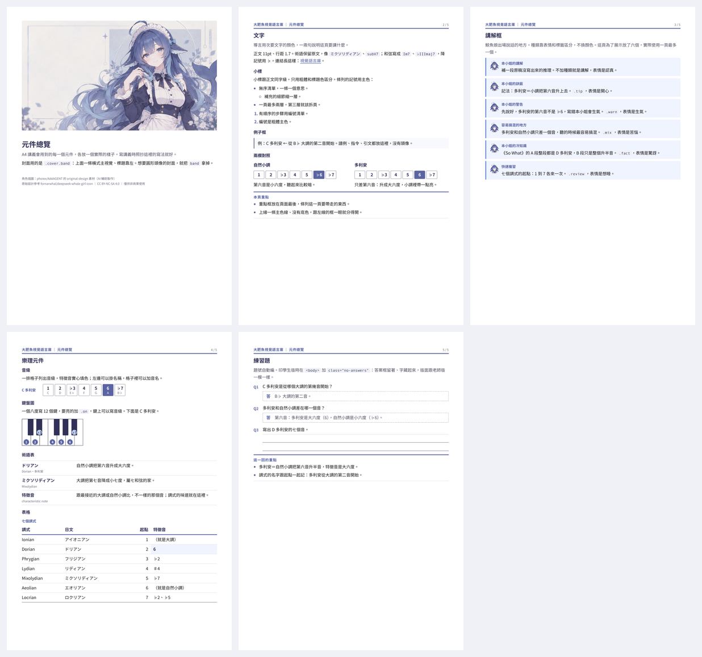
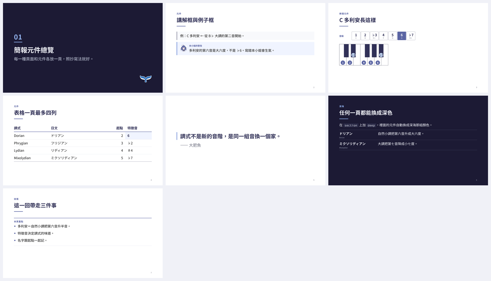

# 元件

A4 講義和 16:9 簡報共用同一組元件，寫法完全一樣，字級和間距跟著載體走（A4 小、簡報大）。實際的樣子看 [A4 元件總覽](../examples/components.pdf) 和 [簡報元件總覽](../examples/components-deck.pdf)。





## 怎麼引用

- A4 連 `templates/doc.css`，簡報連 `templates/deck.css`。兩份都會自動載入 `tokens.css`（顏色、字體、字級）和 `components.css`（這頁的元件）。
- 素材路徑寫在 CSS 裡（講解框的頭像、章節頁的尾巴），所以 HTML 要連 repo 裡的 `templates/`，不要把 CSS 單獨複製出去。

## 文字

- **頁標題** `h2`、**小標** `h3`。小標跟正文同字級，只用粗體和標題色區分。
- **導言** `<p class="lede">`：頁標題下面一兩句，說這頁要講什麼。
- **條列** `ul`、`ol`：記號是主色，最多兩層，第三層就拆頁。
- **行內程式碼** `code`：和弦記號、級數、術語、檔名。不會被拆到兩行。
- **連結** `a`：主色加細底線。

## 例子框 `.ex`

譜例、指令、引文這種「不是正文」的東西。中性灰線、沒有頭像，一頁可以有好幾個。

```html
<div class="ex">例：C 多利安 ← 從 B♭ 大調的第二音開始。</div>
```

- 內容用「例：」開頭最清楚。
- 左線是中性灰，對白底至少 3:1，印成黑白也看得到邊界。

## 講解框 `.whale`

鯨魚娘出場說話的地方。種類靠**表情和標籤**區分，不換顏色：

- （不加）**講解**　認真　補一段原稿沒寫出來的推理
- `.tip` **訣竅**　開心　記法、捷徑
- `.warn` **警告**　生氣　常見錯誤
- `.mix` **易混**　苦惱　兩個很像、容易搞混的東西
- `.fact` **冷知識**　驚訝　意外的事實、小故事
- `.review` **複習**　想睡　前面講過的東西再提一次

```html
<div class="whale tip">
  <span class="av"></span>
  <div class="txt"><span class="who"></span>記法：多利安＝小調把第六音升上去。</div>
</div>
```

- 頭像寫 `<span class="av"></span>`，會照種類自動換表情；要用別張圖就寫 ``。
- 標籤 `<span class="who"></span>` 留空會填預設文字（「本小姐的訣竅」這類），寫了字就用你寫的。
- 一頁最多一個，最多三行。超過就拆頁。
- 口吻見 [CHARACTER.md 的「講解框的語氣」](CHARACTER.md#講解框的語氣)。

## 重點框 `.summary`

頁尾整理這一頁要帶走的東西。上緣一條主色線、沒有底色，跟左線的兩種框一眼就分得開。

```html
<div class="summary">
  <ul>
    <li>多利安＝自然小調把第六音升半音。</li>
  </ul>
</div>
```

- 標籤預設「本頁重點」，要換就加 `data-label="這一回的重點"`。
- 放在頁面最後，最多四條。

## 表格 `table`

並列比較時用，只在 A4 和簡報用；Markdown 筆記照舊不用表格。

```html
<table>
  <caption>七個調式</caption>
  <thead><tr><th>調式</th><th class="num">起點</th><th>特徵音</th></tr></thead>
  <tbody>
    <tr><td>Dorian</td><td class="num">2</td><td class="key">6</td></tr>
  </tbody>
</table>
```

- 表頭下一條主色線，列與列之間細線，沒有直線、沒有斑馬紋。
- 數字欄加 `.num` 靠右。要特別指出的格子加 `.key`：粗體加淡底，印成黑白靠粗體辨認，不要改字的顏色。
- 最多四欄。簡報一頁最多四列，多了就拆頁。

## 音級 `.degrees`

一排格子列出音級，特徵音實心填色。

```html
<div class="degrees" data-label="C 多利安">
  <span>1<small>C</small></span><span>2<small>D</small></span><span>♭3<small>E♭</small></span>
  <span>4<small>F</small></span><span>5<small>G</small></span><span class="key">6<small>A</small></span><span>♭7<small>B♭</small></span>
</div>
```

- `data-label` 是左邊的名稱，可以不寫。
- 格子裡的 `<small>` 寫音名，可以不寫。
- 特徵音只標真正不一樣的音。像洛克里安有兩個，就標兩個。

## 鍵盤圖 `.keys`

一個八度寫 12 個 `<i>`，照半音順序：C、C♯、D、D♯、E、F、F♯、G、G♯、A、A♯、B。

```html
<div class="keys">
  <i class="on">1</i><i></i><i class="on">2</i><i class="on">♭3</i><i></i><i class="on">4</i>
  <i></i><i class="on">5</i><i></i><i class="on">6</i><i class="on">♭7</i><i></i>
</div>
```

- 要亮的鍵加 `.on`，鍵上出現一個圓點，裡面可以寫標籤。
- 標籤寫音級或音名，一張圖裡擇一，不要混。
- 兩個八度以上：每 12 個鍵用 `<span class="oct">…</span>` 包起來，排在同一個 `.keys` 裡。
- 顏色固定鋼琴的黑白，放在深色頁上也不反轉。

## 術語表 `.terms`

原文、另一種寫法、中文說明，一行一個術語。

```html
<dl class="terms">
  <dt>ドリアン<span>Dorian・多利安</span></dt><dd>自然小調把第六音升成大六度。</dd>
</dl>
```

- 原文放 `dt`，讀音或另一種寫法放 `dt` 裡的 `span`，中文說明放 `dd`，一句話講完。

## 練習題 `.quiz`

題號自動編成 Q1、Q2……

```html
<ol class="quiz">
  <li>C 多利安是從哪個大調的第幾音開始？
    <div class="answer">B♭ 大調的第二音。</div>
  </li>
  <li>寫出 D 多利安的七個音。
    <div class="lines" style="--n: 2"></div>
  </li>
</ol>
```

- `.answer` 是答案框；`.lines` 是給學生寫字的橫線，`--n` 是幾條。
- 印學生版：在 `<body>` 加 `class="no-answers"`。答案框留著、字藏起來，版面跟老師版一模一樣。

## 兩欄對照 `.cols`

兩個東西並排比較，例如自然小調和多利安。

```html
<div class="cols">
  <div><h3>自然小調</h3>…</div>
  <div><h3>多利安</h3>…</div>
</div>
```

- 只放兩欄。兩欄的結構要一樣（同樣的小標、同樣的元件），讀者才比得出差別。

## 封面

- **A4**　預設是 `.cover`：58mm 圓形頭像、標題置中。`.cover.band` 是另一種：上面一條橫式主視覺、標題靠左。
- **簡報**　`.slide.cover` 疊在主視覺上。留白在右的圖加 `.right`，沒有乾淨留白的加 `.scrim`，疊在暗部加 `.dark`。每張主視覺該用哪個，見 [README 的「選圖」](../README.md#選圖)。

## 簡報頁型

- **一般頁**　`.kicker` 章節名、`h2` 標題、`.rule` 短線、`.body` 內容，`.pageno` 留空自動填頁碼。
- **左文右圖**　`.two-col`：文字 52%、圖 48%，垂直置中。
- **章節頁**　`.slide.section`：`.num` 章節號、`h2` 章名、`.lede` 一句話。預設深色，右下角有尾巴；要淺色就加 `.light`。
- **引言頁**　`.slide.quote`：`blockquote` 一句話撐一整頁，出處寫在 `.cite`。
- **滿版圖**　`figure.full`：圖填滿標題下面的空間。
- **收尾頁**　`.center`：標題和一句話置中。

## 深海（深色頁）

在任何容器加 `.deep`，裡面的元件會自動換成深海那組顏色，不用改寫。

- 簡報的章節頁預設就是深色。整份簡報都要深色，就在 `<body>` 加 `class="deep"`；封面上的字不會跟著背景圖自動換色，深色簡報的封面記得加 `.scrim`。
- VS Code 是深色主題時，Markdown 預覽也會自動換成深海。
- 鍵盤圖和講解框的頭像不變色。

## Markdown 筆記

- 在 VS Code 設定加 `"markdown.styles": ["templates/markdown.css"]`，預覽就會套用同一組配色和字體。
- 起點是 [`templates/note-template.md`](../templates/note-template.md)。
- 引用（`>`）就是例子框；表格和 `---` 分隔線照舊不用。
